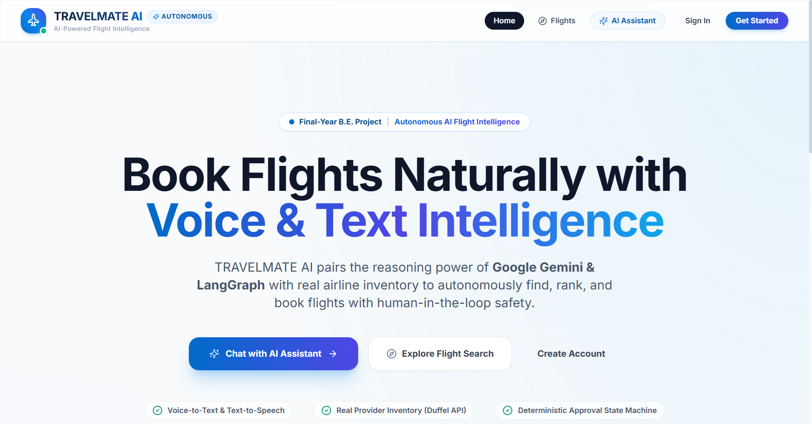
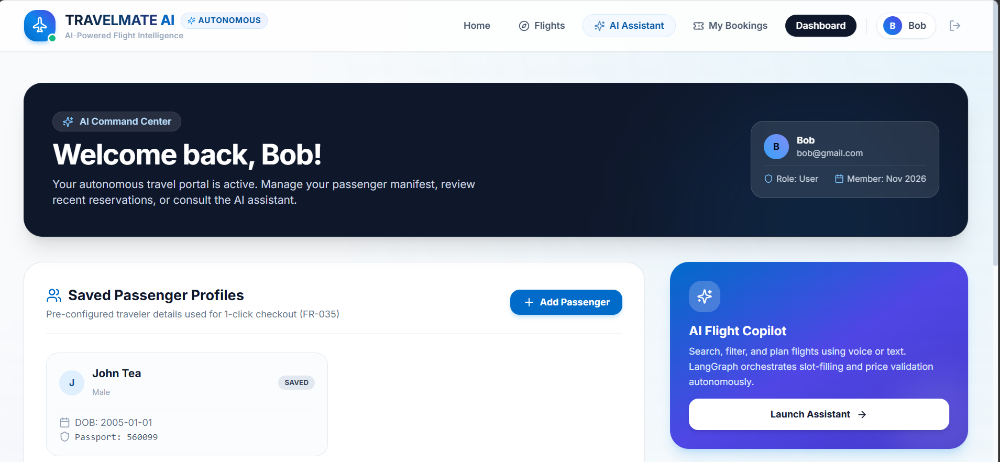
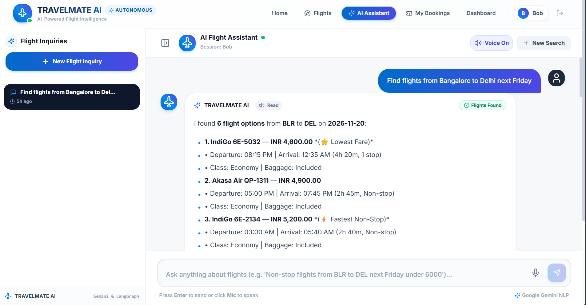
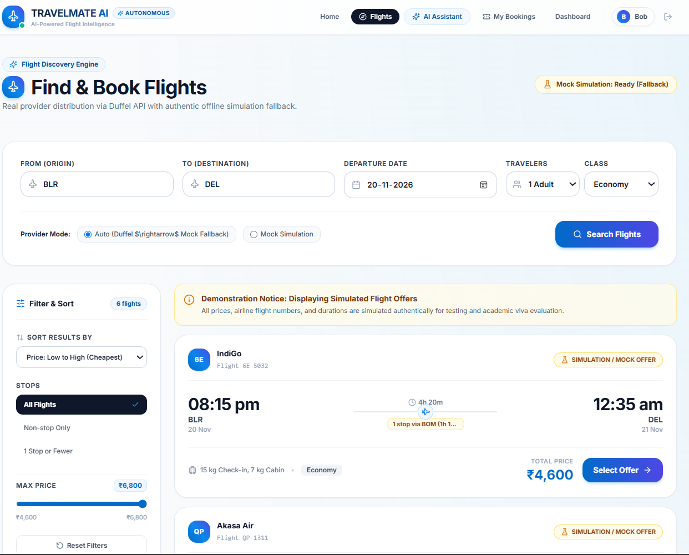
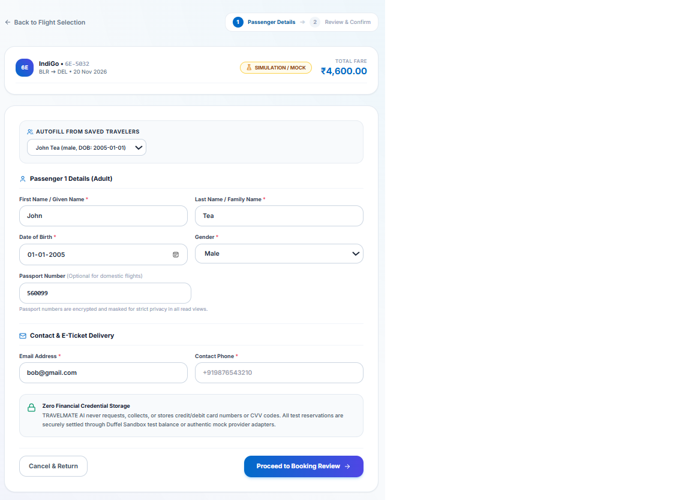
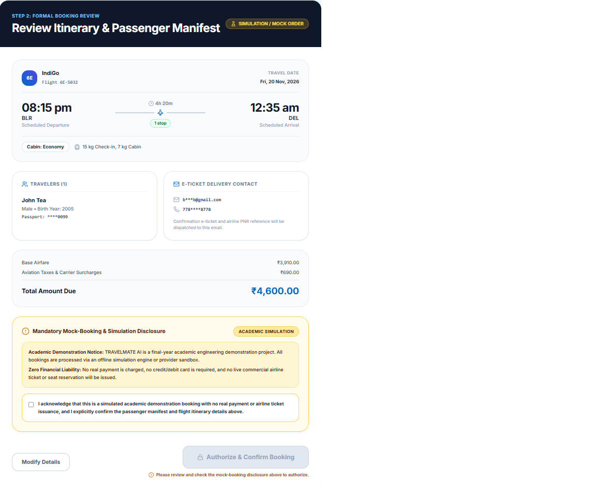

# ✈️ TRAVELMATE AI
### An AI-Powered Autonomous Flight Booking Assistant with Voice and Text Interaction

TRAVELMATE AI is an intelligent flight booking assistant designed to simplify the flight search and booking experience through natural language conversations and voice interaction.

The application combines Artificial Intelligence, conversational workflows, and full-stack web development to help users search for flights, manage passenger information, review itineraries, and complete an academic booking simulation.

> **Academic Project Disclaimer:** This project currently uses simulated flight offers and mock booking workflows for demonstration purposes. It does not issue real airline tickets or process actual payments.

---

## 🌟 Key Features

- **AI-Powered Travel Assistant:** Interact with the assistant using natural language.
- **Voice Interaction:** Supports speech-to-text and text-to-speech communication.
- **Flight Search:** Search flights using origin, destination, travel date, and passenger count.
- **Conversational Flight Search:** Extract travel requirements from user messages.
- **Flight Offers:** Display flight details, schedules, fares, and available mock offers.
- **User Authentication:** Registration and login functionality.
- **Passenger Management:** Add and manage passenger information.
- **Booking Simulation:** Review itineraries and complete a simulated booking workflow.
- **Booking History:** View previous bookings and itinerary details.
- **Booking Validation:** Includes confirmation consent and price-change handling.
- **Responsive Interface:** Modern frontend designed for different screen sizes.

---

## 📸 Application Screenshots

### 1. Home Page


### 2. Dashboard


### 3. AI Chat Assistant


### 4. Flight Search Results


### 5. Passenger Details


### 6. Booking Review


---

## 🛠️ Technology Stack

| Component | Technologies |
|---|---|
| Frontend | React.js, JavaScript |
| Styling | Tailwind CSS |
| Build Tool | Vite |
| Backend | Python, FastAPI |
| AI Integration | Google Gemini API |
| AI Orchestration | LangGraph |
| Voice Interaction | Web Speech API |
| Database | SQLite |
| ORM | SQLAlchemy |
| Testing | Pytest, JavaScript tests |
| Version Control | Git and GitHub |

---

## 🏗️ System Architecture

The application follows a full-stack architecture with separate frontend, backend, AI, and database components.

```text
                  USER
                    |
                    v
             REACT FRONTEND
             (Vite + Tailwind)
                    |
                    v
              FASTAPI BACKEND
                    |
          +---------+---------+
          |         |         |
          v         v         v
       AI MODULE  SERVICES  AUTHENTICATION
          |         |
          v         v
      GEMINI API  FLIGHT / BOOKING
      LANGGRAPH   MANAGEMENT
                    |
                    v
              SQLITE DATABASE
```

---

## 📁 Project Structure

```text
TRAVELMATE-AI/
│
├── backend/
│   ├── app/
│   │   ├── adapters/
│   │   ├── ai/
│   │   ├── api/
│   │   ├── core/
│   │   ├── models/
│   │   ├── schemas/
│   │   ├── services/
│   │   └── main.py
│   │
│   ├── tests/
│   ├── requirements.txt
│   └── .env.example
│
├── frontend/
│   ├── src/
│   │   ├── components/
│   │   ├── context/
│   │   ├── hooks/
│   │   ├── pages/
│   │   ├── services/
│   │   └── utils/
│   │
│   ├── package.json
│   └── .env.example
│
├── screenshots/
│   ├── 01-homepage.png
│   ├── 02-dashboard.png
│   ├── 03-ai-chat.png
│   ├── 04-flight-results.png
│   ├── 05-passenger-details.png
│   └── 06-booking-review.png
│
├── .gitignore
└── pytest.ini
```

---

## ⚙️ Installation and Setup

### Prerequisites

Install the following before running the application:

- Python 3.10 or later
- Node.js and npm
- Git
- Google Gemini API key (if using Gemini integration)

### 1. Clone the Repository

```bash
git clone https://github.com/akshay2005-15/TRAVELMATE-AI.git
```

```bash
cd TRAVELMATE-AI
```

### 2. Backend Setup

Create a Python virtual environment:

```powershell
python -m venv backend/venv
```

Activate the environment:

```powershell
.\backend\venv\Scripts\Activate.ps1
```

Install the required dependencies:

```powershell
pip install -r backend/requirements.txt
```

Create the backend environment file:

```powershell
Copy-Item backend/.env.example backend/.env
```

Configure your environment variables in `backend/.env`.

Important configuration examples:

```env
ENVIRONMENT=development
PORT=8000
GEMINI_API_KEY=your_gemini_api_key
FLIGHT_PROVIDER=mock
```

Use your own secure secret key and configure the remaining variables according to your environment. Keep actual credentials private.

Start the backend:

```powershell
$env:PYTHONPATH="backend"
python -m uvicorn app.main:app --app-dir backend --reload --port 8000
```

Backend URL:

http://localhost:8000

API documentation:

http://localhost:8000/docs

### 3. Frontend Setup

Open another terminal in the project root.

Install frontend dependencies:

```bash
npm --prefix frontend install
```

Create the frontend environment file:

```powershell
Copy-Item frontend/.env.example frontend/.env
```

Start the frontend:

```bash
npm --prefix frontend run dev
```

Frontend URL:

http://localhost:5173

### 4. Run the Application

Keep both backend and frontend terminals running.

Open the following URL in your browser:

http://localhost:5173

You can now explore the TRAVELMATE AI application.

---

## 🧪 Testing

The project includes backend and frontend tests for important application workflows.

Backend tests:

```powershell
$env:PYTHONPATH="backend"
python -m pytest backend/tests -v
```

Frontend production build:

```bash
npm --prefix frontend run build
```

---

## 🔐 Security and Privacy

- API keys and secret credentials are stored in local environment files.
- Actual `.env` files are excluded from Git using `.gitignore`.
- Environment example files contain placeholders only.
- Passwords and authentication are handled through the backend.
- No actual payment card processing is implemented.

**Never upload real API keys, passwords, or secret credentials to GitHub.**

---

## 🚀 Future Enhancements

- Integration with live flight inventory providers.
- Real-time flight availability and pricing.
- Advanced AI-based travel recommendations.
- Improved multilingual voice interaction.
- Travel itinerary recommendations.
- Deployment to a cloud hosting platform.
- Additional automated testing and monitoring.

---

## 👨‍💻 Developer

**Akshay Sadashivanavar**

Information Science and Engineering

Akash Institute of Engineering and Technology

GitHub: [@akshay2005-15](https://github.com/akshay2005-15)

---

⭐ If you find this project interesting, feel free to explore the repository and its implementation.

**TRAVELMATE AI – Making flight booking conversations smarter and simpler.**
